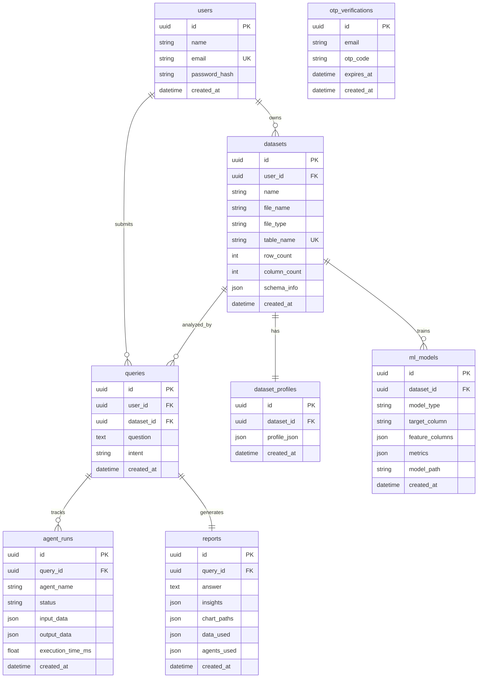
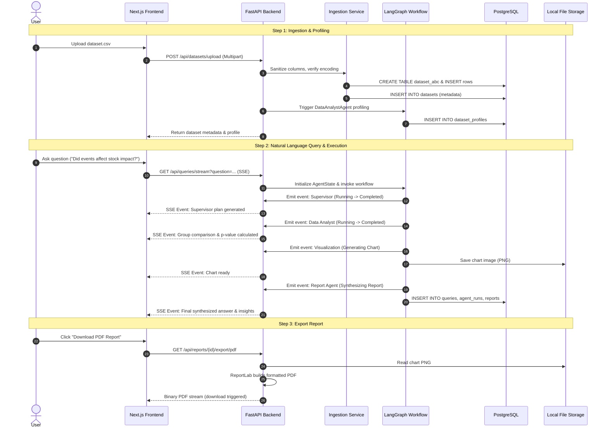

# AI MADAC — Autonomous Multi-Agent Data Science Analyst
## Comprehensive Project Work, Architecture & Viva Documentation

> **Project Name:** AI MADAC (Multi-Agent Data Analytics Companion)  
> **Repository:** `SaiSiddharth1/ai-madac`  
> **Target Audience:** Project Reviewers, Faculty Evaluators, Technical Viva Examiners, Developers, and Open Source Contributors  
> **Document Purpose:** Complete, ground-truth record of implemented architecture, active codebase features, database models, multi-agent workflows, and viva defense guidelines.

---

## 1. Executive Summary

**AI MADAC** is an enterprise-ready, autonomous multi-agent platform designed to democratize and automate end-to-end data science workflows. Users upload raw tabular datasets (`CSV` or `XLSX`), explore auto-generated statistical profiles, and pose natural-language queries ranging from standard data aggregation to complex statistical relationship investigations and machine-learning forecasting.

Behind the interface sits a **LangGraph-orchestrated multi-agent system** powered by Large Language Models (LLMs). The supervisor dynamically decomposes user queries, plans multi-step agent executions, routes tasks to specialized agents (SQL, Data Analyst, Machine Learning, Visualization, RAG, and Report Synthesis), and streams live execution status to a responsive Next.js frontend over Server-Sent Events (SSE).

---

## 2. Implementation Status Audit (Ground-Truth Matrix)

To maintain absolute academic and technical integrity during project reviews, all features are categorized into **Implemented**, **Partially Implemented**, and **Planned / Future Work** based strictly on the current repository codebase.

```
+---------------------------------------------------------------------------------------+
|                                    PROJECT STATUS                                     |
+---------------------------------------+-----------------------+-----------------------+
|             IMPLEMENTED               | PARTIALLY IMPLEMENTED |        PLANNED        |
| - JWT Auth & OTP Password Reset       | - Vector Store / RAG  | - Production Docker   |
| - Dataset Upload & PG Table Ingestion |   Schema Indexing     |   Frontend Container  |
| - Automated Statistical Profiling     | - Automated Test      | - Celery / Redis      |
| - LangGraph 6-Agent StateGraph        |   Coverage            |   Background Workers  |
| - Real-time SSE Agent Streaming       | - Re-indexing on Data | - Cross-Dataset Joins |
| - SQL Agent with Guardrails           |   Replacement         | - Rate Limiting &     |
| - Automated Scikit-Learn ML Training  |                       |   Brute-force Shield  |
| - Plotly / Matplotlib Visualizations  |                       | - Custom User Role    |
| - ReportLab PDF & JSON Export         |                       |   Permissions (RBAC)  |
| - Full Next.js 14/15 Dashboard UI     |                       |                       |
+---------------------------------------+-----------------------+-----------------------+
```

### 2.1 Fully Implemented Features (Verified in Codebase)

1. **User Authentication & Authorization (`backend/app/api/auth.py`, `frontend/app/login`, `register`, `forgot-password`)**:
   - Secure account registration with bcrypt password hashing (`passlib`).
   - JWT-based authentication (OAuth2 password bearer workflow with HS256 algorithm).
   - Time-limited (10-minute) OTP verification for forgotten password resets with email/console dispatch.
   - Protected route middleware in FastAPI using dependency injection (`get_current_user`).

2. **Dataset Management & Dynamic Ingestion (`backend/app/services/dataset_service.py`, `backend/app/api/datasets.py`)**:
   - Ingestion of CSV and XLSX formats up to 50MB.
   - Multi-encoding recovery fallback (`utf-8-sig`, `utf-8`, `cp1252`, `iso-8859-1`) preventing decode crashes.
   - Conservative cleaning (deduplication, empty row pruning, column whitespace trimming).
   - Dynamic table generation: Each uploaded dataset is assigned an isolated PostgreSQL table (`dataset_<short_id>`) with sanitized column identifiers.
   - Schema extraction (column names, inferred SQL types, nullability, unique counts, sample values).
   - Immediate automatic statistical profiling upon upload.

3. **Multi-Agent LangGraph Workflow (`backend/app/graphs/workflow.py`, `backend/app/agents/`)**:
   - Dynamic StateGraph orchestration with an explicit `AgentState` schema.
   - **Supervisor Agent (`supervisor/agent.py`)**: Intent classification (`DATA_RETRIEVAL`, `AGGREGATION`, `RELATIONSHIP_ANALYSIS`, `PREDICTION`, `VISUALIZATION`, `GENERAL_DATASET_ANALYSIS`) with heuristic analytical triggers and dynamic ordered execution plan generation.
   - **SQL Agent (`sql/agent.py`)**: Natural-language to PostgreSQL dialect translation, SQL security AST/regex validation (blocking `INSERT`, `UPDATE`, `DELETE`, `DROP`, `ALTER`), metric guardrails (enforcing `SUM` over `COUNT` for financial/volume totals).
   - **Data Analyst Agent (`data_analyst/agent.py`)**: Automated column profiling, deep bivariate/multivariate relationship analysis, two-sample Welch's t-test hypothesis evaluations, and missingness quantification.
   - **Machine Learning Agent (`ml/agent.py`)**: Target column heuristic detection, task classification (regression vs. classification), label encoding, train/test splitting, `RandomForestClassifier` / `RandomForestRegressor` fitting, metrics generation (Accuracy, Precision, Recall, F1 or MAE, MSE, RMSE, R²), and Joblib serialization.
   - **Visualization Agent (`visualization/agent.py`)**: Intelligent chart type selection (bar, line, scatter, distribution), Plotly and Matplotlib generation, and static image export to `/static/charts/`.
   - **Report Agent (`report/agent.py`)**: Enterprise-grade multi-agent synthesis combining numerical findings, exact missingness counts, explicit causality cautions, and bulleted takeaways.

4. **Real-Time Streaming & Observability (`backend/app/core/workflow_events.py`, `backend/app/api/queries.py`)**:
   - Async event hub broadcasting agent state changes (`running`, `completed`, `failed`).
   - Server-Sent Events (SSE) `/api/queries/stream` consumption on the frontend via EventSource.
   - Persistence of queries, execution metrics, per-agent run logs (`AgentRun`), and final reports (`Report`) in PostgreSQL.

5. **Report Export Engine (`backend/app/services/report_service.py`, `backend/app/api/reports.py`)**:
   - ReportLab PDF generator rendering document metadata, question, synthesized executive summary, embedded chart visuals, and bulleted insights.
   - JSON export API for raw programmatic access.

6. **Full-Featured Frontend Dashboard (`frontend/`)**:
   - Next.js App Router (React 19 / TypeScript) styled with Tailwind CSS.
   - Interactive Chat Interface (`ChatInterface.tsx`) with real-time agent workflow status stepper (`AgentWorkflow.tsx`), status badges (`AgentStatusBadge.tsx`), tabular data inspection, SQL query display, and Plotly chart renderers.
   - Dedicated Dataset Explorer with schema cards and profile summaries (`ProfileSummary.tsx`).
   - Dedicated ML Model Training Studio (`/dashboard/models`) allowing users to pick a dataset, select target and feature columns, inspect performance metrics, and submit live prediction queries.
   - Reports gallery with instant PDF download buttons (`/dashboard/reports`).

---

### 2.2 Partially Implemented Features

1. **RAG Knowledge Retrieval (`backend/app/core/vector_store.py`, `backend/app/agents/rag/agent.py`)**:
   - **Implemented:** ChromaDB vector store integration with OpenAI embeddings (and fallback `FakeEmbeddings`), indexing dataset column schemas, types, and sample values; similarity search filtering by `dataset_id`.
   - **Needs Completion:** Dynamic re-indexing when datasets are updated; automated ingestion of external unstructured enterprise documents (e.g., data dictionaries, PDF company reports) beyond raw column schemas.
2. **Automated Testing Suite (`backend/tests/`)**:
   - **Implemented:** Unit tests for supervisor intent classification, SQL validation, metric guardrails (`test_intent_and_sql.py`, `test_sql_metric_guardrails.py`), and report synthesis (`test_report_agent.py`).
   - **Needs Completion:** Comprehensive frontend component unit tests, mock API tests, and end-to-end Cypress/Playwright integration tests.

---

### 2.3 Planned / Proposed Features (Not Implemented)

1. **Production Docker Deployment**:
   - Frontend container service is defined but commented out in `docker-compose.yml`.
   - Production Nginx reverse proxy configuration and production SSL certificate lifecycle.
2. **Distributed Asynchronous Task Queues**:
   - Celery / Redis task queue integration for massive dataset ingestion (>500MB) and hyperparameter grid searches.
3. **Cross-Dataset Multi-Table Federation**:
   - Joins across multiple disparate uploaded datasets within the same query.
4. **API Rate Limiting & Enterprise Security Controls**:
   - Redis-backed rate-limiting on authentication and model training endpoints.
   - Role-Based Access Control (RBAC) supporting Admin, Data Scientist, and Viewer roles.

---

## 3. High-Level System Architecture

```mermaid
flowchart TD
    User([User Browser]) -->|HTTP / SSE| Frontend[Next.js Frontend\nTailwind CSS + React 19]
    
    subgraph Backend [FastAPI Application]
        Router[API Gateway / Routers\nAuth | Datasets | Queries | ML | Reports]
        AuthService[Auth & OTP Service]
        DatasetService[Dataset Ingestion &\nSanitization Service]
        ReportService[ReportLab PDF Engine]
        WorkflowEventManager[Async Workflow Event Manager\nSSE Streaming Hub]
        
        subgraph LangGraphWorkflow [LangGraph Orchestration Engine]
            Supervisor[Supervisor Agent\nIntent Classification & Planner]
            RouterNode{route_next\nConditional Router}
            
            SQL[SQL Agent\nSafe SELECT Generator]
            Analyst[Data Analyst Agent\nEDA, Stats & Impact Analysis]
            ML[ML Agent\nRandomForest & Inference]
            Viz[Visualization Agent\nPlotly / Matplotlib]
            RAG[RAG Agent\nChromaDB Schema Retrieval]
            Report[Report Agent\nSynthesis & Causality Caution]
        end
    end
    
    subgraph DataStorage [Storage & Databases]
        PG[(PostgreSQL Database\nUsers, Metadata, Dynamic Tables)]
        VectorDB[(ChromaDB Vector Store\nDataset Schema Embeddings)]
        DiskFiles[Local Storage\n/charts, /models, /uploads]
    end

    Frontend --> Router
    Router --> AuthService
    Router --> DatasetService
    Router --> ReportService
    Router --> LangGraphWorkflow
    
    LangGraphWorkflow -.->|SSE Events| WorkflowEventManager
    WorkflowEventManager -.->|EventStream / SSE| Frontend
    
    Supervisor --> RouterNode
    RouterNode --> SQL
    RouterNode --> Analyst
    RouterNode --> ML
    RouterNode --> Viz
    RouterNode --> RAG
    RouterNode --> Report
    
    SQL --> PG
    Analyst --> PG
    ML --> DiskFiles
    Viz --> DiskFiles
    RAG --> VectorDB
    Report --> PG
```

---

## 4. Multi-Agent System Architecture (LangGraph Deep Dive)

The core intelligence of AI MADAC is powered by **LangGraph**, transforming disjoint LLM calls into a resilient, cyclical, state-driven multi-agent system.

### 4.1 State Schema (`AgentState`)

All agents operate over a shared, immutable-updating typed state dictionary (`backend/app/agents/state.py`):

```python
class AgentState(TypedDict):
    query_id: str                      # Unique query UUID for session tracing
    user_id: str                       # Requesting user identity
    dataset_id: str                    # Target dataset identifier
    table_name: str                    # Physical PostgreSQL table name
    question: str                      # User's natural language question
    intent: str                        # Classified intent
    execution_plan: list[str]          # Ordered agent pipeline determined by Supervisor
    agents_used: list[str]             # Execution tracking history
    schema: dict[str, Any]             # Dataset schema metadata
    dataset_profile: dict[str, Any]    # Pre-calculated statistical profile
    sql_query: str | None              # Generated SQL statement
    sql_result: dict[str, Any] | None  # Raw execution rows and columns
    analysis_result: dict[str, Any]    # Statistical, group, and hypothesis findings
    ml_result: dict[str, Any] | None   # Model training metrics or prediction outputs
    visualization_result: dict | None  # Generated chart file path and metadata
    rag_result: dict[str, Any] | None  # Retrieved schema context
    final_report: dict[str, Any] | None# Final synthesized answer and insights
    errors: list[str]                  # Aggregated execution warnings/errors
```

### 4.2 Agent Node Specifications

| Agent Name | Primary Responsibility | Input State Keys | Output State Keys | Fallback / Guardrail Behavior |
| :--- | :--- | :--- | :--- | :--- |
| **Supervisor Agent** | Intent classification and execution planning | `question`, `schema`, `dataset_profile` | `intent`, `execution_plan` | Heuristic keyword overrides ("impact", "affect", "difference") prevent misclassification as simple retrieval. |
| **SQL Agent** | NL-to-SQL translation and execution | `question`, `table_name`, `schema` | `sql_query`, `sql_result`, `errors` | AST regex validation rejects all mutating statements; metric guardrail forces `SUM` instead of `COUNT` on monetary requests. |
| **Data Analyst Agent** | In-depth statistical EDA & relationship analysis | `table_name`, `question`, `schema` | `analysis_result` | Computes two-sample t-test and explicit missingness rates; handles empty tables gracefully. |
| **ML Agent** | Autonomous model training and inference | `table_name`, `target_column`, `features` | `ml_result` | Checks row count minimums; auto-selects between Classifier and Regressor based on target cardinality. |
| **Visualization Agent** | Plotly & Matplotlib chart generation | `sql_result`, `analysis_result`, `question` | `visualization_result` | Selects optimal chart type (bar, line, scatter); gracefully exits if tabular data is missing or scalar. |
| **RAG Agent** | Schema context similarity retrieval | `question`, `dataset_id` | `rag_result` | ChromaDB vector search; safely falls back to empty context if vector store is unavailable. |
| **Report Agent** | Final report synthesis | Outputs of all preceding agents | `final_report` | Strictly enforces causal skepticism rules and displays exact numerical findings in the opening paragraph. |

### 4.3 Conditional Router Logic (`route_next`)

The workflow employs dynamic routing rather than a hardcoded chain:

1. Starts at `START -> supervisor`.
2. `supervisor` classifies the intent and outputs an ordered list: `execution_plan = ["data_analyst_agent", "visualization_agent", "report_agent"]`.
3. The conditional edge `route_next(state)` inspects `execution_plan` and `agents_used`.
4. It directs execution to the first agent in `execution_plan` that has not yet run.
5. If all plan agents are visited, it forces routing to `report_agent`.
6. `report_agent` always transitions directly to `END`.
7. `_record_agent_completion` ensures nodes returning empty artifacts do not trigger infinite routing loops.

---

## 5. Database Schema & Data Models

The relational persistence layer uses PostgreSQL (with SQLite local fallback support) orchestrated through **SQLAlchemy ORM** (`backend/app/db/models.py`).



---

## 6. End-to-End User Journey & Data Flow



---

## 7. Technology Stack Reference

| Layer | Technology | Version / Spec | Justification & Usage |
| :--- | :--- | :--- | :--- |
| **Backend Framework** | FastAPI | `>= 0.110.0` | Asynchronous performance, auto-generated OpenAPI documentation, native SSE streaming support. |
| **Orchestration** | LangGraph / LangChain | `>= 0.0.30` / `>= 0.1.0` | StateGraph architecture enables cyclical loops, conditional branch routing, and structured state tracking across multiple agents. |
| **Database & ORM** | PostgreSQL & SQLAlchemy | Postgres 16, SQLAlchemy 2.0 | High concurrency via `asyncpg` for app queries; `psycopg2` / sync engine for direct Pandas reflection. |
| **Vector Database** | ChromaDB | `>= 0.4.0` | Embeds schema metadata and column descriptions for semantic context retrieval. |
| **Machine Learning** | Scikit-Learn | `>= 1.4.0` | Automated model selection (`RandomForestClassifier`, `RandomForestRegressor`), metrics calculation, and Joblib serialization. |
| **Analytics & Stats** | Pandas, NumPy, SciPy | Latest stable | Tabular manipulation, two-sample t-test statistical validation, and missingness quantification. |
| **Visualization** | Plotly & Matplotlib | `plotly >= 5.20.0` | Interactive JSON charts for the web client; static PNG image exports for PDF reports. |
| **PDF Generation** | ReportLab | Latest stable | Programmatic document layout rendering executive summaries, tables, and embedded chart figures. |
| **Frontend Framework** | Next.js (React 19 / TS) | App Router (14/15) | Server-side rendering, typed API contracts, component modularity, and smooth EventSource SSE integration. |
| **Styling** | Tailwind CSS | Latest | Modern, responsive dark-mode enterprise UI design with Lucide React iconography. |

---

## 8. Viva Voce & Technical Defense Q&A

This section prepares team members for examination by faculty panels, external reviewers, and technical leads.

### Q1: Why did you choose a Multi-Agent architecture instead of a single monolithic LLM prompt?
> **Answer:**  
> A single monolithic prompt suffers from context pollution, hallucinations, high token costs, and an inability to reliably run code or enforce security. In our multi-agent architecture:
> - **Specialization:** Each agent has a dedicated system prompt and strict operational scope (e.g., the SQL agent generates SQL and nothing else; the Analyst agent runs statistical algorithms).
> - **Deterministic Execution:** Agents run actual Python and SQL code in the loop rather than having an LLM "guess" numerical calculations.
> - **Explainability & Observability:** The supervisor produces an explicit execution plan, and each agent emits discrete status events stored in the database (`AgentRun`), enabling fine-grained debugging.

### Q2: How does AI MADAC protect against SQL injection and harmful data manipulation?
> **Answer:**  
> We employ a multi-layered defense strategy:
> 1. **Read-Only Generation:** The SQL Agent system prompt strictly forbids anything other than `SELECT` queries.
> 2. **Deterministic SQL Validation:** Before any query reaches the database, it passes through `validate_sql()` (`backend/app/utils/sql_validator.py`). This utility uses regular expression matching and AST checks to reject destructive keywords (`DROP`, `DELETE`, `UPDATE`, `INSERT`, `ALTER`, `TRUNCATE`, `EXEC`).
> 3. **Table & Column Sanitization:** Table names are generated by the backend (`dataset_<short_id>`) and validated through `sanitize_table_name()` against a strict whitelist format. Column identifiers are sanitized during ingestion to remove semicolons, quotes, and malicious tokens.

### Q3: How do you prevent hallucinations in financial and statistical metrics?
> **Answer:**  
> We enforce architectural and deterministic guardrails:
> 1. **SQL Metric Guardrails:** We enforce rules that prohibit mapping financial volume questions (e.g., "What was the total commitment?") to `COUNT(*)`. The SQL agent is instructed to use `SUM(column)` with explicit `NULL` filtering.
> 2. **Deterministic Python Computations:** For relationship questions, the Data Analyst agent executes Pandas aggregations and SciPy t-tests (`scipy.stats.ttest_ind`) directly on the dataset table, producing mathematical p-values and group means.
> 3. **Causality Skepticism in the Report Agent:** The prompt enforces strict rules: if missingness in a key field is high (e.g., 97% missing event data), the report MUST state that the data does not provide sufficient evidence to conclude a true causal effect, completely preventing false positive claims.

### Q4: How does real-time streaming work between FastAPI and Next.js?
> **Answer:**  
> We implement **Server-Sent Events (SSE)** via FastAPI's `StreamingResponse`:
> - The client opens a persistent HTTP connection to `/api/queries/stream?question=...`.
> - In the backend, `workflow_event_manager` acts as an async event queue for each `query_id`.
> - As each LangGraph node transitions (`supervisor_node`, `sql_node`, `data_analyst_node`), it emits an event (`running`, `completed`, `failed`).
> - The frontend `EventSource` / `fetch` reader listens to incoming JSON packets and dynamically updates the visual stepper in `AgentWorkflow.tsx` in real-time.

### Q5: How does the system handle diverse, messy real-world datasets?
> **Answer:**  
> In `backend/app/services/dataset_service.py`:
> 1. **Encoding Auto-Detection:** Many real-world CSVs fail under standard UTF-8. We implement a sequential fallback mechanism (`utf-8-sig`, `utf-8`, `cp1252`, `iso-8859-1`).
> 2. **Header Sanitization:** Column names with spaces, special punctuation, or SQL reserved words are converted into snake_case lowercase identifiers.
> 3. **Dynamic Table Isolation:** Each dataset is given its own isolated physical table in PostgreSQL, preventing schema collision between different users or uploads.

---

## 9. Academic Contribution & Viva Presentation Outline

### 9.1 Summary of Novel Contributions
- **Autonomous Analytical Planning:** Combining intent classification with deterministic analytical keyword detection to dynamically route questions between direct SQL queries and statistical hypothesis testing.
- **Enterprise Causality Verification:** An automated reporting layer that flags observational biases, small sample sizes, and severe missingness rather than blindly asserting correlation as causation.
- **Full-Stack Agent Observability:** Complete end-to-end trace recording from user question to individual agent run logs, chart persistence, and verifiable PDF exports.

### 9.2 Recommended Slide Deck Structure for Final Review
1. **Slide 1: Title & Team Credentials** — AI MADAC: Autonomous Multi-Agent Data Science Analyst.
2. **Slide 2: Problem Statement** — Limitations of existing monolithic LLMs (hallucinated calculations, lack of code execution, SQL security risks).
3. **Slide 3: Proposed Architecture** — High-level diagram showing Next.js, FastAPI, LangGraph, and PostgreSQL.
4. **Slide 4: The Multi-Agent Ecosystem** — Roles of Supervisor, SQL, Analyst, ML, Visualization, RAG, and Report Agents.
5. **Slide 5: Security & Metric Guardrails** — SQL validation, AST checks, and financial SUM vs. COUNT rules.
6. **Slide 6: Live Demo / Workflow Walkthrough** — Uploading dataset, SSE streaming query, interactive chart rendering, and model training.
7. **Slide 7: Experimental Results & Performance** — Query routing latency, ML model accuracy scores, PDF export artifacts.
8. **Slide 8: Current Implementation Status vs. Roadmap** — Transparent breakdown of implemented vs. planned modules.
9. **Slide 9: Conclusion & Viva Defense** — Key takeaways and Q&A.
